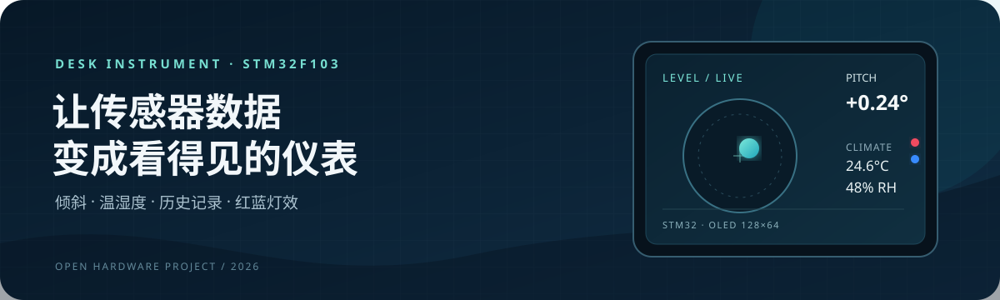
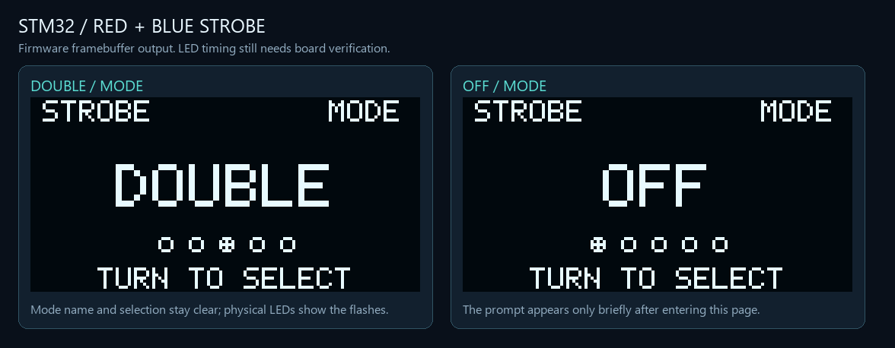

<div align="center">



# STM32 多功能小仪表

**一块 STM32F103C8T6，集倾斜测量、温湿度、数据记录与灯效于一体。**

[下载固件](level_dashboard_2026-10-09/firmware/level.hex) · [新手接线](level_dashboard_2026-10-09/docs/wiring-beginner.md) · [页面操作](level_dashboard_2026-10-09/docs/dashboard.md) · [工程说明](level_dashboard_2026-10-09/README.md) · [E 版技术白皮书](level_dashboard_2026-10-09/docs/STM32多功能小仪表-固件技术白皮书-V2026.10.10E-修复版.pdf)


</div>

## 这个项目能做什么

它以 MPU6050 水平测量为核心，用 128×64 I²C OLED 显示数据，通过旋转编码器翻页。DHT11 提供温湿度，W25QXX 保存测量和开机记录，三路 LED 可显示水平偏移，也有独立的红蓝灯效页面。

<div align="center">



红蓝灯效独立页面 · 五种节奏可选

</div>

| 页面 | 你能看到什么 |
|---|---|
| LEVEL / CLIMATE | 水平状态、角度和偏移灯效 / 温度与相对湿度 |
| HISTORY / SYSTEM | 测量记录 / 设备、复位原因与 Flash 状态 |
| RAW DATA / TREND / DEBUG | MPU 原始数据 / 约 12 秒趋势 / 传感器与调度诊断 |
| STROBE | OFF、ALT、DOUBLE、TRIPLE、CHASE 红蓝模式 |
| RUNTIME / SESSIONS | 本次开机时长 / 历史开机检查点 |

## 三步开始

1. **先看接线。** 从[新手教程](level_dashboard_2026-10-09/docs/wiring-beginner.md)开始，断电插线，所有模块共地，按 3.3V 逻辑连接。
2. **烧录固件。** 下载[当前公开 HEX](level_dashboard_2026-10-09/firmware/level.hex)，使用 ST-Link 烧录；也可先核对[SHA-256](level_dashboard_2026-10-09/firmware/SHA256SUMS.txt)。
3. **逐项验收。** 上电查看启动自检，放平完成校准，再按[页面指南](level_dashboard_2026-10-09/docs/dashboard.md)检查传感器、灯光与记录功能。

要改源码，请安装 Keil MDK 和 ARM Compiler 5.06 update 7，在 Windows PowerShell 执行：

```powershell
Set-Location .\level_dashboard_2026-10-09
.\build.cmd
```

构建脚本会调用 Keil 并生成 `MDK-ARM/Obj/level.hex`。公开 E 版构建结果为 0 错误、0 警告，ROM 31,536 B，RW+ZI 8,048 B。更多细节见[工程说明](level_dashboard_2026-10-09/README.md)。

## 接线先记住这些

| 模块 | 引脚 | 注意事项 |
|---|---|---|
| OLED 与 MPU6050 | PB6=SCL，PB7=SDA | I²C 共用；OLED 地址 0x3C，MPU6050 地址 0x68 |
| DHT11 | PA1 | 裸传感器 DATA 需 4.7kΩ 上拉；小板先检查是否自带 |
| W25QXX | PA4=CS，PA5=CLK，PA6=MISO，PA7=MOSI | 仅用 3.3V，WP/HOLD 上拉 |
| 编码器 A/C/B | PB0=A，GND=C，PB1=B | 旋转翻页；此模块没有按压开关 |
| RGB LED | PA8/PA9/PA10 | 每颗 LED 串联 330Ω，阴极接 GND |
| 蜂鸣器 | PB8 | 当前模块低电平触发 |

完整面包板图、每步怎么插和每步应看到什么，都在[新手接线教程](level_dashboard_2026-10-09/docs/wiring-beginner.md)。

## 发布版本与验收状态

当前仓库发布的是 **V2026.10.10E**，屏显版本 `20261010E`。已有实机记录覆盖早期水平仪、DHT11 与编码器翻页；E 版新增会话记录仍需在真实板上验收。公开文件包括[当前固件](level_dashboard_2026-10-09/firmware/level.hex)、[上一版固件](level_dashboard_2026-10-09/firmware/level_previous.hex)和[校验清单](level_dashboard_2026-10-09/firmware/SHA256SUMS.txt)。

突然断电时，设备无法写入准确的结束时刻；历史记录以最近一次 Flash 存活检查点作为开机时长下界。功能不依赖 RTC、日期或 VBAT。详见[会话记录说明](level_dashboard_2026-10-09/docs/sessions.md)和[验证记录](level_dashboard_2026-10-09/docs/validation.md)。

## 文档导航

- [新手接线教程：电源、电阻、模块与分步验收](level_dashboard_2026-10-09/docs/wiring-beginner.md)
- [页面、引脚和旋转操作](level_dashboard_2026-10-09/docs/dashboard.md)
- [开机时长与会话记录边界](level_dashboard_2026-10-09/docs/sessions.md)
- [STROBE 灯效模式](level_dashboard_2026-10-09/docs/strobe.md)
- [故障排查与实机验收](level_dashboard_2026-10-09/docs/validation.md)
- [E 版固件技术白皮书 PDF](level_dashboard_2026-10-09/docs/STM32多功能小仪表-固件技术白皮书-V2026.10.10E-修复版.pdf)
- [变更记录](level_dashboard_2026-10-09/CHANGELOG.md)

## 仓库目录

```text
level/                       早期水平仪参考工程
level_dashboard_2026-10-09/  当前公开 E 版源码、固件和文档
```

PC 仿真框架已按项目需求移除。源码使用 GBK，Markdown 使用 UTF-8，构建脚本使用 CRLF；修改源码时请参照工程说明中的编码规则。
