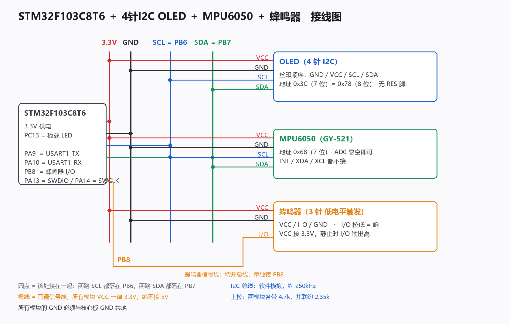

<div align="center">


# STM32 多功能小仪表 · E 版工程

**V2026.10.10E · STM32F103C8T6 · Keil AC5 · 公开发布工程**

[固件 HEX](firmware/level.hex) · [新手接线](docs/wiring-beginner.md) · [页面指南](docs/dashboard.md) · [验证清单](docs/validation.md) · [技术白皮书 PDF](docs/STM32多功能小仪表-固件技术白皮书-V2026.10.10E-修复版.pdf)


</div>

## 工程简介

这份目录包含 GitHub 当前发布的 E 版源码、Keil 工程、HEX 固件和配套文档。设备以 MPU6050 倾斜测量为核心，使用 OLED 与旋转编码器交互，并扩展温湿度、Flash 历史、诊断、红蓝灯效和开机时长记录。

> 屏显版本为 `20261010E`。构建已通过 Keil ARM Compiler 5.06 update 7（0 错误、0 警告）；E 版新增会话记录等功能仍须烧录到实物后逐项验收。软件构建通过不等于硬件验收通过。

## 快速上手

1. 先按[新手接线教程](docs/wiring-beginner.md)连接最小系统；接线、改电阻或插拔模块前先断电。
2. 下载 [firmware/level.hex](firmware/level.hex)，通过 ST-Link 烧录；需要确认文件时查看 [SHA256SUMS.txt](firmware/SHA256SUMS.txt)。
3. 上电观察 POST 自检结果，平放设备等待校准，然后旋转编码器翻页检查各页面。
4. 逐个接入 DHT11、W25QXX 和 LED，按[验证清单](docs/validation.md)核对可观察结果。

Windows 下用 Keil 打开 `MDK-ARM/level.uvprojx` 并按 F7 编译；也可以在本目录执行：

```powershell
.\build.cmd
```

脚本查找 Keil `UV4.exe` 并输出 `MDK-ARM/Obj/level.hex`。如果自动找不到 Keil，直接从 Keil 打开工程编译，自动查找失败时，可在 Keil 中直接打开工程；构建脚本为 [build.cmd](build.cmd)。

## 页面导览

| 页面 | 内容与用途 |
|---|---|
| LEVEL | 气泡、俯仰与横滚；红灯亮度随偏移增加 |
| CLIMATE | DHT11 温度、湿度和读取状态 |
| HISTORY | Flash 中保存的倾斜测量记录 |
| SYSTEM | 固件、复位原因、器件与 Flash 状态 |
| RAW DATA | MPU6050 六轴原始值和芯片温度原值 |
| TREND | 最近约 12 秒的角度变化，重启后清空 |
| DEBUG | 传感器帧、错误计数、PWM、输入与节拍诊断 |
| STROBE | 独立红蓝灯效：OFF、ALT、DOUBLE、TRIPLE、CHASE |
| RUNTIME | 本次开机计时与可用历史检查点比较 |
| SESSIONS | 浏览 BOOT 与 ALIVE 会话记录 |

当前编码器接线为 A→PB0、C→GND、B→PB1；手上模块没有按压触点，因此所有交互都可只靠旋转完成。PB10 是可选独立按钮。

## 硬件引脚速查

| 模块 | 接线 | 补充要求 |
|---|---|---|
| 4 针 I²C OLED + MPU6050 | PB6=SCL、PB7=SDA | 共用总线、共地；OLED 0x3C，MPU6050 0x68 |
| 蜂鸣器 | PB8 | 当前模块低电平触发 |
| DHT11 | PA1 | 裸器件 DATA 用 4.7kΩ 上拉至 3.3V；小板通常自带 |
| W25QXX SPI1 | PA4=CS、PA5=CLK、PA6=MISO、PA7=MOSI | 3.3V；WP/HOLD 上拉至 3.3V |
| 编码器 | PB0=A、C=GND、PB1=B | 供电 3.3V；无需按压键 |
| 红/绿/蓝 LED | PA8/PA9/PA10 | 每颗单独串 330Ω，阴极接 GND |
| 可选独立按钮 | PB10 与 GND | 常开按钮，不接也能旋转操作 |
| ST-Link | PA13=SWDIO、PA14=SWCLK、GND | 核心板 USB 供电时不接 ST-Link 3.3V |



## 自检状态怎么看

- `DONE`：本次真实通信、读回、扫描或写入核验成功。
- `ERR`：检查失败；`SKIP`：条件不足，没有执行。
- `LOCK`：Flash 中存在未知内容，程序保护数据并停止写入。
- `CFG`：只确认 MCU 的 GPIO/PWM 寄存器配置，不能证明实体 LED 亮度或蜂鸣器声音正常。
- `EVENT DONE`：本次 BOOT 事件已写入并读回确认。

启动自检分屏可在 POST 页面通过旋转查看。页面与交互细节见[dashboard.md](docs/dashboard.md)。

## 开机时长与 Flash 边界

`RUNTIME` 显示本次开机时间；Flash 每分钟写入一次存活检查点。意外断电时无法再写最终时长，所以旧会话显示最近检查点形成的时长下界，通常存在约一分钟误差。没有有效检查点时会显示 `NO CHECKPOINT`。项目不使用 RTC 日期或 VBAT。存储容量有限，较新记录会逐步覆盖更早的记录，详见[会话设计说明](docs/sessions.md)。

记录区位于 Flash 末尾 64 KB，前 8 KB 为会话事件区。不要全片擦除或随意修改区域边界；遇到未知记录时 `LOCK` 是保护行为。

## 文档索引

| 文档 | 内容 |
|---|---|
| [wiring-beginner.md](docs/wiring-beginner.md) | 从最小系统开始的接线步骤、电阻和验收 |
| [dashboard.md](docs/dashboard.md) | 页面行为、引脚与编码器操作 |
| [validation.md](docs/validation.md) | 软件检查结果和烧板验收步骤 |
| [sessions.md](docs/sessions.md) | 会话事件、时长下界与容量限制 |
| [strobe.md](docs/strobe.md) | 红蓝灯效模式和操作 |
| [build.cmd](build.cmd) | Windows 下调用 Keil 的构建脚本 |
| [固件技术白皮书](docs/STM32多功能小仪表-固件技术白皮书-V2026.10.10E-修复版.pdf) | E 版架构、模块与代码详解 |
| [变更记录](CHANGELOG.md) | 发布版本变更 |

## 编码与修改约定

工程源码 `USER/*.c`、`*.h` 使用 GBK 编码；Markdown 使用 UTF-8。修改中文源码时先转 UTF-8，编辑后再转回 GBK。`.cmd`/`.bat` 必须保持 CRLF。编译生成的 `MDK-ARM/Obj/` 文件是构建产物。
